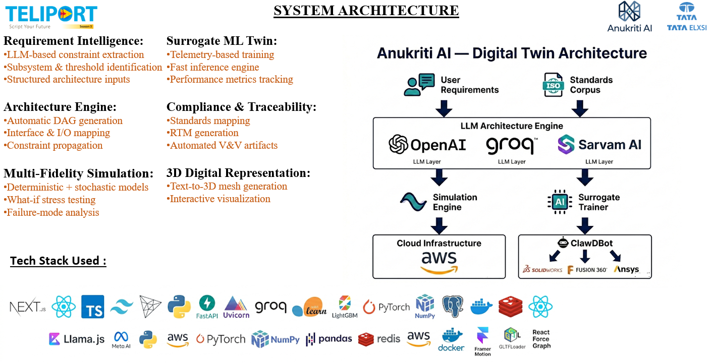
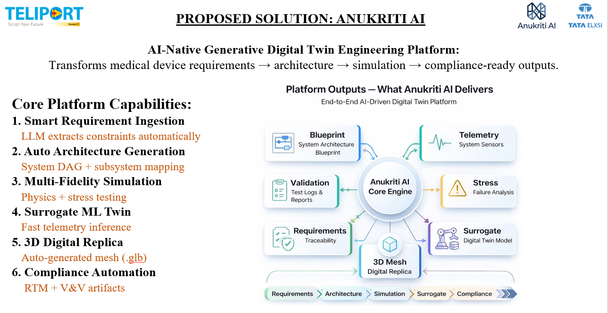

<div align="center">

# Anukriti AI

### Generative System Engineering & Digital Twin Platform for Medical Devices

*Translate natural-language device requirements into physics-validated, ML-surrogate digital twins — running entirely on edge hardware.*

[](LICENSE)
[](https://nextjs.org)
[](https://fastapi.tiangolo.com)
[](https://python.org)
[](https://raspberrypi.com)

**[▶ Watch the Demo Video](https://www.youtube.com/watch?v=KSuAD4G1Zug)**

</div>

---

## Table of Contents

- [Team Details](#team-details)
- [College / Incubator Information](#college--incubator-information)
- [Project Title](#project-title)
- [Problem Statement](#problem-statement)
- [Healthcare Use Case](#healthcare-use-case)
- [Technical Stack](#technical-stack)
- [AI/ML Model & Framework Details](#aiml-model--framework-details)
- [Demo Video](#demo-video)
- [Architecture Diagram](#architecture-diagram)
- [Presentation](#presentation)
- [System Architecture](#system-architecture)
- [Getting Started](#getting-started)
- [API Reference](#api-reference)
- [Repository Structure](#repository-structure)
- [Open-Source License](#open-source-license)

---

## Team Details

**Team Name:** Team Anukriti Ai

| Name | Role | GitHub |
|---|---|---|
| Harsh Yadav | Team Leader | [@Hazz-Y](https://github.com/Hazz-Y) |
| Avishkar Jaiswal | Team Member | — |
| Amol Bhatia | Team Member | — |
| Prayag Sharma | Team Member | [@prayag-1771](https://github.com/prayag-1771) |

---

## College / Incubator Information

| Field | Detail |
|---|---|
| **Institution** | Vellore Institute of Technology (VIT), Chennai |
| **School** | School of Computer Science and Engineering |
| **Programme** | B.Tech |
| **Location** | Chennai, Tamil Nadu, India |

---

## Project Title

**Anukriti AI — Generative System Engineering & Digital Twin Platform for Medical Devices**

---

## Problem Statement

Medical device development typically takes **6 to 18 months** from concept to validated design. The bottleneck is rarely manufacturing — it is that the engineering lifecycle is fragmented across disconnected tools:

| Gap | Consequence |
|---|---|
| **Manual requirement engineering** | Natural-language specifications are translated by hand into formal requirements — slow, inconsistent and error-prone. |
| **Disconnected architecture modelling** | System topology is drawn manually in separate tools, with no traceable link back to the requirements that justify each component. |
| **Late physics validation** | Thermal, electrical and fluid behaviour is verified only during physical prototyping, so design faults surface when correction is most expensive. |
| **Manual regulatory mapping** | Compliance with IEC 60601-1, ISO 13485 and ISO 14971 is a separate documentation exercise, duplicating engineering effort. |

The result is long cycles, expensive late-stage redesign, and a high barrier to entry for small MedTech teams.

**Anukriti AI collapses this chain into a single automated pipeline**, taking a plain-English device description through to a physics-validated, deployable digital twin.

---

## Healthcare Use Case

Anukriti AI targets the **design and verification phase of regulated medical devices** — specifically battery-powered, patient-contact devices such as:

- **Infusion and insulin pumps** — flow rate accuracy, occlusion detection latency, reservoir depletion
- **Patient monitors** — sensor signal integrity, ADC quantisation, drift and SNR
- **Ventilators** — motor drive response, pressure regulation
- **Portable diagnostic devices** — battery endurance, thermal safety, electrical isolation

### Clinical and Regulatory Value

| Capability | Healthcare impact |
|---|---|
| **Early safety detection** | Leakage current is simulated against the IEC 60601-1 limit of **100 µA**, and thermal rise against patient-contact surface limits — flagging hazards before any hardware exists. |
| **Requirements traceability** | Every architectural component carries the requirement IDs it satisfies, producing the audit trail regulators expect. |
| **Risk classification** | Each generated requirement is assigned a safety class (A / B / C) aligned to IEC 62304 software safety classification. |
| **Faster time-to-patient** | Compressing design cycles means validated, life-critical devices reach patients sooner. |
| **Accessibility** | The entire platform runs on a Raspberry Pi 5, lowering the cost barrier for resource-constrained research groups and startups. |

> **Scope note:** Anukriti AI is a **design-stage engineering aid**. It does not diagnose, treat, or make clinical decisions, and is not itself a regulated medical device. Its simplified physics solvers are intended for early design exploration and should be validated against certified FEM/CFD tooling before any regulatory submission.

---

## Technical Stack

### Frontend — `anukriti-portal`

| Technology | Version | Purpose |
|---|---|---|
| Next.js | 16.1.6 | App Router, server rendering, production build |
| React | 19.2.3 | UI component model |
| TypeScript | 5.x | Static typing |
| Tailwind CSS | 4.x | Design system and styling |
| Framer Motion | 12.x | Animation and transitions |
| Three.js | 0.183 | 3D topology and mesh rendering |
| lucide-react | 0.575 | Iconography |
| react-joyride | 2.9 | Onboarding walkthrough |

### Backend — `anukriti-core`

| Technology | Version | Purpose |
|---|---|---|
| FastAPI | 0.100+ | REST API and orchestration layer |
| Uvicorn | 0.20+ | ASGI server |
| Pydantic | 2.x | Schema validation and typed models |
| NumPy | 2.x | Numerical physics solvers |
| Pandas | 2.x | Telemetry data handling |
| scikit-learn | 1.3+ | Surrogate model training |
| NetworkX | 3.x | Directed graph construction |
| Joblib | 1.3+ | Model serialisation |
| Groq SDK | 0.33+ | LLM inference client |

### Infrastructure

| Technology | Purpose |
|---|---|
| Docker + Docker Compose | Containerised multi-service deployment |
| Raspberry Pi OS (64-bit, Debian 13) | Edge deployment target |
| Render / AWS Elastic Beanstalk | Cloud deployment configurations |

---

## AI/ML Model & Framework Details

Anukriti AI combines **three distinct computational layers**. Only the first is generative; the other two are deterministic numerical and statistical methods.

### 1. Large Language Model Layer — *Groq Inference*

| Property | Detail |
|---|---|
| **Provider** | Groq Cloud (OpenAI-compatible API) |
| **Model** | `openai/gpt-oss-20b` (131k context window) |
| **Configurable via** | `GROQ_MODEL` environment variable |
| **Output mode** | Enforced JSON (`response_format: json_object`) |
| **Temperature** | 0.1–0.3 for structured extraction; 0.7 for descriptive prompts |

Four engines use the LLM:

| Engine | Module | Function |
|---|---|---|
| **Requirement Engine** | `core/requirements/engine.py` | Parses natural language into typed requirements with safety classes and numeric constraints |
| **Graph Builder** | `core/graph/builder.py` | Synthesises the system topology (DAG) from requirements |
| **Simulation Manager** | `core/simulation/manager.py` | Selects which physics models to run and derives their parameters |
| **Compliance Engine** | `core/compliance/engine.py` | Audits requirements against IEC 60601-1 / ISO 13485 |

Every LLM stage has a deterministic fallback — rule-based graph construction and a default simulation configuration — so the platform degrades gracefully without an API key.

### 2. Numerical Physics Layer — *NumPy Solvers*

Implemented in `core/simulation/engine.py`. **No machine learning is involved** — these are closed-form and numerically integrated models.

| Model | Method |
|---|---|
| **Battery discharge** | Modified Shepherd model with polarisation and exponential zones; State-of-Charge tracking |
| **Thermal** | Newton's law of cooling with power dissipation, solved by forward Euler integration |
| **RC electrical circuit** | First-order step response, time constant and settling time |
| **Fluid flow** | Peristaltic pump model with pulsation, cumulative volume and line pressure |
| **Motor drive** | DC motor with back-EMF, torque and inertia, integrated step-wise |
| **Signal response** | Sensor signal with drift, Gaussian noise, ADC quantisation and SNR |
| **Leakage current** | Insulation degradation with temperature coefficient, checked against the IEC 60601-1 100 µA limit |
| **Sensor response** | First-order response with noise and saturation limits |

### 3. Surrogate ML Layer — *scikit-learn Ensemble*

Implemented in `core/training/pipeline.py`.

| Property | Detail |
|---|---|
| **Architecture** | Ensemble of `GradientBoostingRegressor` + `MLPRegressor`, predictions averaged |
| **GB configuration** | 50 estimators, max depth 3, learning rate 0.1, subsample 0.8 |
| **MLP configuration** | Hidden layers (32, 16), ReLU, Adam optimiser, early stopping |
| **Features** | Time-derived basis functions — polynomial (t, t², t³), logarithmic, square-root, sinusoidal (1×, 2×, 4×, 8×) and exponential decay |
| **Targets** | One model trained per simulation output channel |
| **Preprocessing** | `StandardScaler` applied to the feature matrix |
| **Validation** | 80/20 train-test split, evaluated by MAE, RMSE and R² |
| **Serialisation** | `joblib` compressed `.pkl` artefact |
| **Inference** | Served at `POST /runtime/infer` with model-agreement confidence scoring |

> **Methodological note:** the surrogate learns a mapping from *time* to device output channels for a given simulation run. It reproduces the simulated trajectory efficiently; generalising across arbitrary operating conditions would require conditioning the feature space on those parameters, which is identified future work.

---

## Demo Video

🎬 **[Anukriti AI — Full Demo Walkthrough](https://www.youtube.com/watch?v=KSuAD4G1Zug)**

<div align="center">

[](https://www.youtube.com/watch?v=KSuAD4G1Zug)

</div>

The demo covers:

1. Hardware walkthrough — Raspberry Pi 5, display and power supply
2. Natural-language requirement ingestion and structured extraction
3. Automatic architecture synthesis and 3D topology exploration
4. Multi-domain physics simulation with live telemetry channels
5. Safety-violation detection against IEC limits
6. Surrogate ML twin training and the resulting model metrics
7. What-if stress testing under injected failure conditions

---

## Architecture Diagram

📄 **[Architecture Diagram (PDF)](docs/submission/Anukriti_AI_Architecture_Diagram.pdf)** · [PowerPoint version](docs/submission/Anukriti_AI_Architecture_Diagram.pptx)

A three-page reference covering the four-layer system architecture (interface, orchestration, intelligence, computation), the seven-stage data flow from device description to digital twin, and the edge deployment topology on a Raspberry Pi 5.

---

## Presentation

📄 **[Project Presentation (PDF)](docs/submission/Anukriti_AI_Presentation.pdf)** · [PowerPoint version](docs/submission/Anukriti_AI_Presentation.pptx)

A 17-slide deck covering the problem, the solution, a walkthrough of the running application, the healthcare use case, the technology stack, measured outcomes from a reference run, and the limitations and roadmap.

---

## System Architecture

```text
 Natural Language Device Description
                │
                ▼
 ┌──────────────────────────────┐
 │  Requirement Engine (LLM)    │  → typed requirements, safety classes, constraints
 └──────────────┬───────────────┘
                ▼
 ┌──────────────────────────────┐
 │  Graph Builder (LLM + DAG)   │  → subsystems, interfaces, traceability edges
 └──────────────┬───────────────┘
                ▼
 ┌──────────────────────────────┐
 │  Simulation Manager (LLM)    │  → selects physics models and parameters
 └──────────────┬───────────────┘
                ▼
 ┌──────────────────────────────┐
 │  Numerical Engine (NumPy)    │  → thermal · electrical · battery · fluid · leakage
 └──────────────┬───────────────┘
                ▼
 ┌──────────────────────────────┐
 │  Training Pipeline (sklearn) │  → GradientBoosting + MLP surrogate ensemble
 └──────────────┬───────────────┘
                ▼
     Digital Twin Artefact (.pkl)  +  Interactive 3D Replica
```

<div align="center">

</div>

<div align="center">

</div>

---

## Getting Started

### Prerequisites

- Python 3.11 or newer
- Node.js 20.9 or newer (required by Next.js 16)
- A Groq API key — free at [console.groq.com](https://console.groq.com)

### Option 1 — Docker Compose

```bash
git clone https://github.com/prayag-1771/Anukriti.git
cd Anukriti

echo "GROQ_API_KEY=your_key_here" > .env
echo "GROQ_MODEL=openai/gpt-oss-20b" >> .env

docker-compose up --build -d
```

- Portal → `http://localhost:3000`
- API documentation → `http://localhost:8003/docs`

### Option 2 — Manual Setup

**Backend**

```bash
cd anukriti-core
python3 -m venv .venv
source .venv/bin/activate          # Windows: .venv\Scripts\activate
pip install -r requirements.txt

printf 'GROQ_API_KEY=your_key_here\nGROQ_MODEL=openai/gpt-oss-20b\n' > .env

uvicorn main:app --host 0.0.0.0 --port 8003
```

**Frontend** (second terminal)

```bash
cd anukriti-portal
npm install
NEXT_PUBLIC_API_URL=http://localhost:8003 npm run build
npm start
```

Open `http://localhost:3000` and confirm the **Core Gateway Connected** indicator is green.

### Option 3 — Raspberry Pi 5 (Edge Deployment)

```bash
# 64-bit Raspberry Pi OS required - verify with: uname -m  (expect aarch64)
sudo apt update && sudo apt full-upgrade -y
sudo apt install -y git python3-venv nodejs npm

git clone https://github.com/prayag-1771/Anukriti.git
cd Anukriti
```

Then follow the manual setup above, building the portal with the Pi's LAN address so other devices can reach it:

```bash
NEXT_PUBLIC_API_URL=http://<pi-ip-address>:8003 npm run build
```

> **Tested configuration:** Raspberry Pi 5 (8 GB), active cooler, Raspberry Pi OS 64-bit (Debian 13), Python 3.13, Node 20.19 — the full stack installs and serves from the device.

### Environment Variables

| Variable | Required | Default | Purpose |
|---|---|---|---|
| `GROQ_API_KEY` | Yes | — | Groq API credential; without it all LLM stages fall back to deterministic mock output |
| `GROQ_MODEL` | No | `openai/gpt-oss-20b` | Model identifier used for inference |
| `MESHY_API_KEY` | No | — | Optional text-to-3D mesh generation |
| `NEXT_PUBLIC_API_URL` | No | `http://localhost:8003` | Backend URL, inlined at frontend **build** time |
| `PORT` | No | `8003` | Backend listen port |

---

## API Reference

| Method | Endpoint | Description |
|---|---|---|
| `GET` | `/` | Health check |
| `POST` | `/projects/create` | Create a project from a device description |
| `GET` | `/projects` | List all projects |
| `GET` | `/projects/{id}` | Retrieve full project state |
| `POST` | `/workflow/generate-requirements` | Natural language → structured requirements |
| `POST` | `/workflow/check-compliance` | Audit requirements against IEC / ISO standards |
| `POST` | `/workflow/build-graph` | Requirements → system architecture DAG |
| `POST` | `/workflow/simulate` | Execute multi-domain physics simulation |
| `POST` | `/workflow/simulate-whatif` | Simulation with injected stress parameters |
| `POST` | `/workflow/train-twin` | Train and serialise the surrogate ML twin |
| `POST` | `/workflow/generate-3d-model` | Generate a 3D device representation |
| `POST` | `/runtime/infer` | Run inference on a trained digital twin |
| `GET` | `/runtime/telemetry/{model_id}` | Trained model metadata and metrics |
| `GET` | `/system/traceability/{req_id}` | Downstream components for a requirement |
| `GET` | `/system/stats` | Platform-wide statistics |

Interactive OpenAPI documentation is served at `/docs`.

---

## Repository Structure

```
Anukriti/
├── README.md                      Project documentation (this file)
├── LICENSE                        MIT licence
├── docker-compose.yml             Multi-container orchestration
├── render.yaml                    Render cloud deployment configuration
├── BUILD_INSTRUCTIONS.md          Build and runtime notes
│
├── anukriti-core/                 FastAPI backend — physics and ML engine
│   ├── main.py                    API routes and application entrypoint
│   ├── requirements.txt           Python dependencies
│   ├── Dockerfile                 Backend container image
│   ├── adapters/                  Inter-subsystem data converters
│   └── core/
│       ├── requirements/          LLM requirement extraction and typed models
│       ├── graph/                 DAG schema and topology builder
│       ├── simulation/            Numerical solvers and orchestration
│       ├── training/              Surrogate model training pipeline
│       ├── compliance/            IEC / ISO audit engine
│       ├── runtime/               Inference API and traceability
│       └── viz/                   3D generation and WebSocket bridge
│
├── anukriti-portal/               Next.js frontend
│   ├── app/
│   │   ├── page.tsx               Command centre dashboard
│   │   ├── requirements/          Requirement intelligence view
│   │   ├── architecture/          Topology graph view (2D and 3D)
│   │   ├── simulation/            Telemetry charts and ML training console
│   │   ├── digital-twins/         3D digital twin console
│   │   ├── components/            Shared UI and Three.js viewers
│   │   └── context/               Global project state
│   ├── package.json               Node dependencies
│   └── Dockerfile                 Frontend container image
│
└── docs/
    ├── images/                    Architecture and analysis figures
    └── submission/                Architecture diagram and presentation (PDF + PPTX)
```

---

## Open-Source License

This project is released under the **MIT License**.

| Field | Detail |
|---|---|
| **Licence** | MIT |
| **Full text** | [LICENSE](LICENSE) |
| **Copyright** | © 2026 Anukriti AI Team |
| **Permissions** | Commercial use · Modification · Distribution · Private use |
| **Conditions** | Licence and copyright notice must be retained |
| **Limitations** | No liability · No warranty |

### Third-Party Licences

| Dependency | Licence |
|---|---|
| Next.js, React | MIT |
| FastAPI, Uvicorn, Pydantic | MIT |
| NumPy, Pandas, scikit-learn, NetworkX | BSD-3-Clause |
| Three.js | MIT |
| Tailwind CSS | MIT |

---

<div align="center">

**Anukriti AI** — compressing medical device design cycles from months to minutes.

Built for accessible, regulation-aware engineering.

</div>
